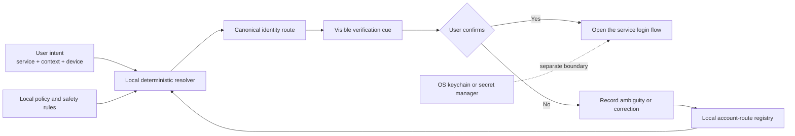

<!--
Property of Not Gone Productions LLC
Architect: M. Scott McKee
Created: 20260915T210027PDT
TIC: 20260915T210027PDT
Model: gpt-5.6-sol
Classification: PUBLIC DRAFT
-->

# Intent-Based Account Routing

People should select intent, not remember identifiers.

Modern users routinely maintain multiple identities across personal, professional, organizational, testing, and device-specific contexts. Services then multiply those identities by treating each authentication provider as a separate account. The result is a recurring decision that humans are poorly served by making from memory:

> Which account am I supposed to use here?

Intent-Based Account Routing replaces that question with a deterministic local lookup:

`service → context → canonical identity → authentication provider → verification cue`

The user states what they are trying to do. The router identifies the correct account path and explains how to verify it. It does not expose credentials, silently authenticate, or make an irreversible account change.

## Core Philosophy

### Intent before identity

An account identifier is an implementation detail. The stable human input is intent: the service, organization, project, role, and device involved in the task.

### Externalize arbitrary memory

Email aliases, private-relay addresses, usernames, tenant IDs, and authentication providers are arbitrary labels. They belong in a machine-readable registry, not in human working memory.

### Same person does not mean same identity

Signing in through Apple, Google, Microsoft, GitHub, passkeys, or direct email can create separate service identities for the same person. The router records these distinctions explicitly.

### Local authority

The account map is controlled by the user and remains local by default. Cloud services may perform authentication, but they are not the authoritative store for the routing policy.

### Explain every decision

Each resolution includes the selected route, its evidence, a visible verification cue, and the last verification time. A route that cannot be explained must not be selected automatically.

### Preserve before consolidating

Duplicate accounts are recorded before any merge, migration, or deletion. Discovery of a duplicate is not authorization to remove it.

## Goals

- Reduce account-selection fatigue and authentication mistakes.
- Provide one authoritative map across services and devices.
- Distinguish human identity from provider-specific service identities.
- Keep routing metadata separate from authentication secrets.
- Make every selection auditable and reversible.
- Detect stale, ambiguous, and conflicting routes.
- Support local-first operation and portable data.

## Non-Goals

- Storing passwords, passkeys, recovery codes, API keys, cookies, or tokens.
- Replacing an operating-system keychain or password manager.
- Bypassing multi-factor authentication or service security controls.
- Automatically merging or deleting duplicate accounts.
- Treating an email address as proof that two accounts are equivalent.
- Making a cloud service authoritative for the user's identity map.

## Architecture



### Components

1. **Intent adapter**
   - Accepts a service, context, role, project, and device.
   - Normalizes aliases to short, stable identifiers.

2. **Route registry**
   - Stores canonical and noncanonical account routes.
   - Contains references and verification metadata, never secrets.
   - Supports JSON for machine use and Markdown for human review.

3. **Deterministic resolver**
   - Matches the most specific valid route.
   - Rejects ambiguous, expired, or unverified results.
   - Returns a reason trace with every decision.

4. **Policy engine**
   - Defines which identities are allowed for each context.
   - Requires confirmation before account switching or external handoff.
   - Prevents destructive consolidation by default.

5. **Verification adapters**
   - Compare visible service state with expected cues such as tenant name, organization, domain suffix, workspace, or device membership.
   - Record only the result and evidence reference.

6. **Secret boundary**
   - Delegates authentication material to the operating-system keychain or a user-selected secret manager.
   - Connects by opaque reference; secret values never enter the route registry or logs.

7. **Audit ledger**
   - Records timestamped route creation, verification, conflict, selection, and correction events.
   - Preserves old-to-new mappings when identities change.

## Data Model

The public schema uses short stable keys. Display labels and provider-specific identifiers may change without changing references throughout the system.

```json
{
  "schema": "account-route/v1",
  "route_id": "ar.example.work",
  "service": "example-service",
  "context": "work",
  "canonical_identity_ref": "id.work.primary",
  "auth_provider": "provider-name",
  "verification": {
    "type": "organization-label",
    "expected": "Example Organization",
    "last_verified_tic": "20260915T210027PDT",
    "evidence_ref": "local:evidence/example"
  },
  "devices": ["device.primary", "device.worker"],
  "secret_ref": "keychain:example-service/work",
  "status": "verified",
  "alternates": ["id.work.duplicate"],
  "recovery_ref": "recovery.example.work"
}
```

`secret_ref` is an opaque pointer. Implementations must never resolve or serialize the secret into route output, logs, exports, diagnostics, or support bundles.

## Resolution Rules

1. Match the exact service.
2. Prefer the most specific context and role.
3. Apply device and organization constraints.
4. Require a canonical identity with valid verification evidence.
5. Reject ties rather than guessing.
6. Present the expected visible verification cue.
7. Require confirmation before opening or changing an external login.
8. Record the result with a local timestamp and decision trace.

Example decision trace:

```text
request: service=example-service context=work device=device.worker
matched: ar.example.work
selected: id.work.primary through provider-name
verify: organization label must equal "Example Organization"
status: confirmation required
```

## Account States

- `verified` — Route and verification cue were confirmed.
- `stale` — Verification exceeded its review interval.
- `ambiguous` — Multiple routes match with equal authority.
- `blocked` — Required identity or provider is unavailable.
- `duplicate` — Valid identity exists but is not canonical for this context.
- `retired` — Preserved for history but prohibited for new sessions.
- `unresolved` — Discovered but not yet mapped.

## Security and Privacy

- Keep private registries outside public source control.
- Encrypt storage at rest where platform support is available.
- Restrict private registry permissions to the owning user.
- Never log authentication URLs or credential-bearing query parameters.
- Redact identity details from public diagnostics.
- Require explicit consent before exporting any private route.
- Sign or hash audit events when tamper evidence is required.
- Treat account switching as an external state change requiring confirmation.
- Preserve duplicate routes until the user explicitly authorizes consolidation.

## Reference Implementation

A minimal local implementation can use:

- **Rust** for the resolver, policy engine, validation, and CLI.
- **JSON** for the canonical machine-readable registry.
- **Markdown** for generated human-readable summaries.
- **OS keychain adapters** for opaque secret references.
- **Append-only local events** for traceability.

Suggested commands:

```text
account-route resolve --service <service> --context <context> --device <device>
account-route verify <route-id>
account-route record-duplicate <route-id> --identity <identity-ref>
account-route audit --since <tic>
account-route export-schema
```

Commands that switch accounts, open authentication flows, or modify external services should require an explicit confirmation step.

## Repository Boundary

A public repository may contain:

- Schema definitions
- Resolver and policy-engine source
- Test fixtures containing fictional identities
- Documentation
- Threat model
- Import and export specifications

It must not contain:

- Real account maps
- Personal email addresses
- Internal device inventories
- Authentication artifacts
- Private audit events
- Secret-manager contents

Private mappings should live in a user-controlled data directory selected at installation time and excluded from version control by default.

## Testing

The implementation should include:

- Deterministic route-selection tests
- Ambiguity rejection tests
- Duplicate-provider identity tests
- Stale-verification tests
- Secret-redaction tests
- Import and export round-trip tests
- Permission and private-path tests
- Audit-trace completeness tests
- Recovery tests that preserve every preexisting route

Tests must use fictional accounts and services.

## Initial Delivery Stages

### Stage 1 — Read-only router

- Local registry
- Deterministic lookup
- Human-readable route explanation
- No authentication automation

### Stage 2 — Verification

- Service-specific verification adapters
- Staleness checks
- Conflict reporting
- Append-only audit events

### Stage 3 — Assisted handoff

- Explicitly confirmed opening of the correct login flow
- OS keychain references
- Account-switch detection
- Recovery guidance

### Stage 4 — Portable personal authority

- Encrypted local export and import
- User-controlled synchronization
- Signed policy bundles
- Multiple-device consistency checks

## Public Release Checklist

- Replace every real identity and topology reference with fictional fixtures.
- Confirm the repository contains no credentials or private route data.
- Document the threat model and secret boundary.
- Select and publish a software license.
- Publish the schema separately from personal data.
- Verify clean installation without network authority.
- Confirm all destructive account operations are disabled by default.

## Principle

Account routing should work like any other reliable routing system: the person declares the destination and context; the system resolves the path, verifies it, and keeps the arbitrary numbers out of human working memory.
